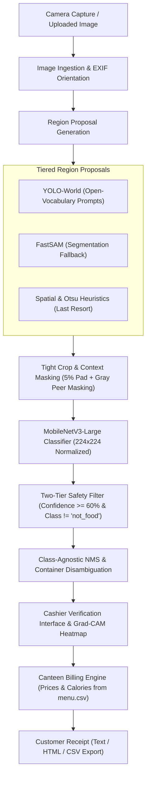
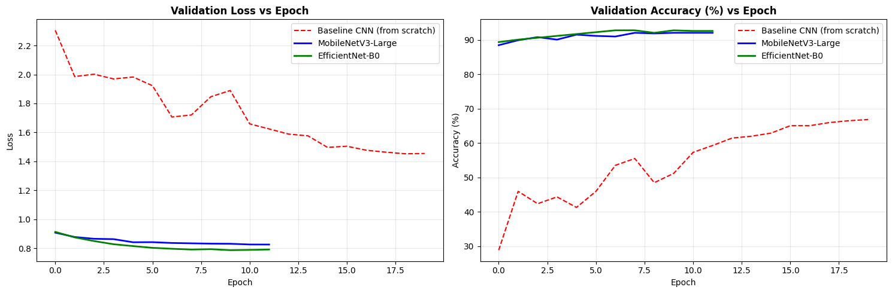
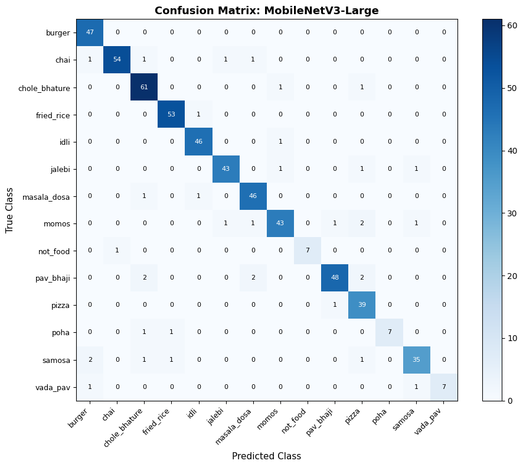
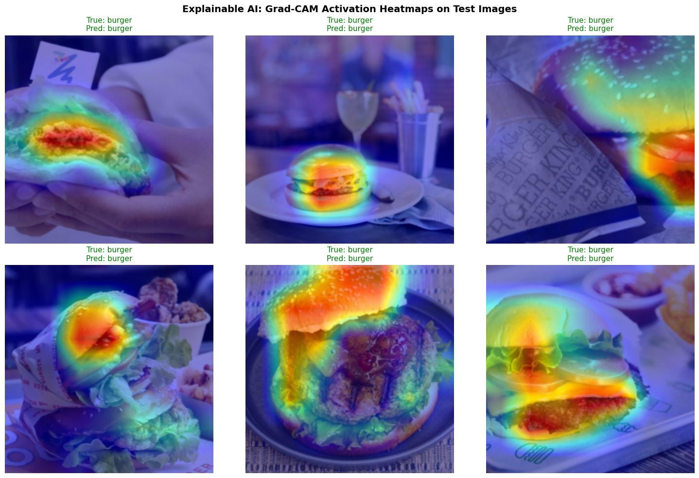
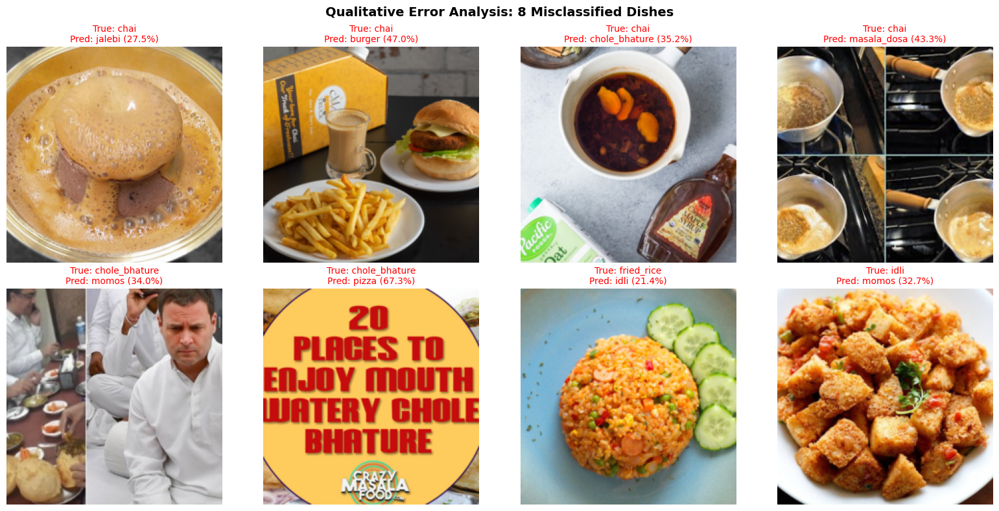
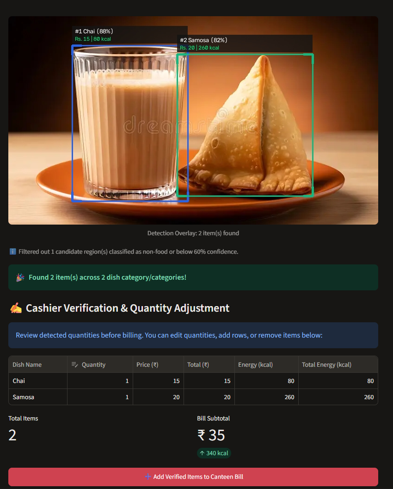
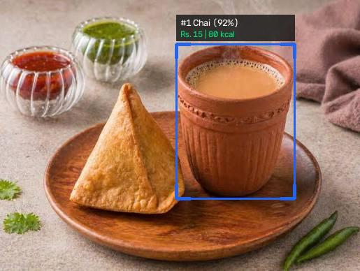
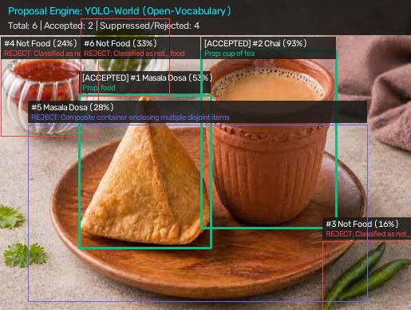
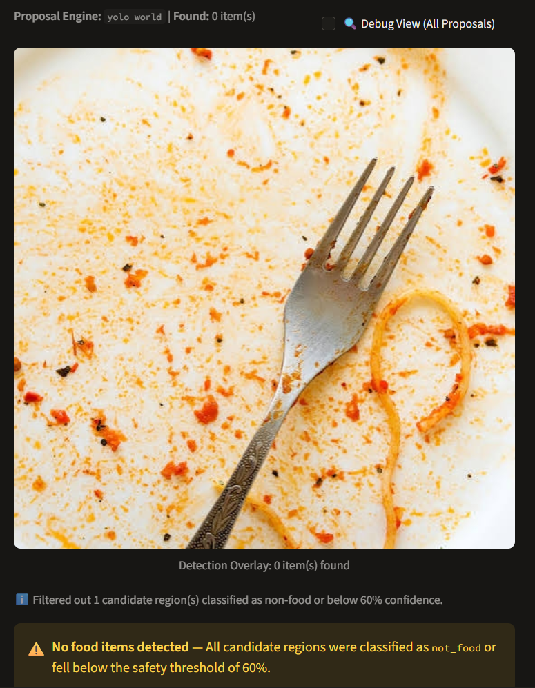
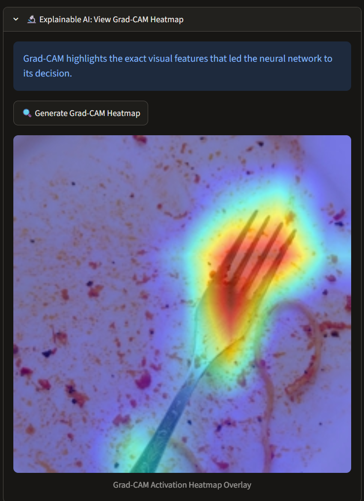

# Smart Canteen Billing Assistant: Food Image Recognition with Transfer Learning

[](https://smart-canteen.streamlit.app)
[](https://www.python.org/downloads/)
[](https://pytorch.org/)


An end-to-end deep learning vision application and point-of-sale billing assistant designed for college canteens and cafeterias. By leveraging transfer learning with a fine-tuned MobileNetV3-Large convolutional neural network and open-vocabulary region proposals (YOLO-World / FastSAM / Spatial Heuristics), the system detects single or multiple Indian food dishes on a plate or tray from photos or live camera feeds, classifies them across **14 classes (13 dishes + not_food)**, calculates prices and nutritional energy (calories), and automatically generates customer receipts.

> **Live Web Demo**: [https://smart-canteen.streamlit.app](https://smart-canteen.streamlit.app)  
> *(Note: On the free cloud the app may run in a lighter detection mode; full multi-item detection runs best locally on a desktop workstation).*

---

## 👥 Project & Team Information

- **Institution**: Ramdeobaba University (RBU), Nagpur
- **Program**: B.Tech in Electronics Engineering | Capstone Project (Deep Learning Lab)
- **Project Title**: Smart Canteen Billing Assistant — Food Image Recognition with Transfer Learning
- **Project Team**:
  1. **Atharva Korde** (Roll No: 08) — *Dataset Collection, Preprocessing Pipeline & Multi-Item Detection Integration*
  2. **Dhruv Khedkar** (Roll No: 13) — *Model Architectures, Transfer Learning Training & Hyperparameter Tuning*
  3. **Divyam Sharma** (Roll No: 14) — *Benchmarking Metrics, Real-World Photo Evaluation & Local Dataset Extension*
  4. **Divyatwa Kiranpure** (Roll No: 15) — *Streamlit UI Application, OpenCV Live Camera HUD & Explainable AI (Grad-CAM)*

---

## 📌 Problem Statement

In bustling university canteens and institutional cafeterias during peak lunch and break hours, manual cashier billing creates long queues, pricing inconsistencies, and billing delays. Traditional barcode and RFID tagging solutions are physically impractical for unpackaged, freshly cooked Indian foods (such as samosas, dosas, poha, and idlis). 

The **Smart Canteen Billing Assistant** addresses this challenge through automated computer vision:
- Instantly recognizes dishes placed on trays or tables from standard camera captures.
- Detects multiple distinct items simultaneously (e.g. Samosa + Chai).
- Rejects non-food objects (empty plates, hands, cutlery, tables) to avoid false financial charges.
- Generates itemized bills with monetary totals (₹) and dietary energy estimates (kcal).

---

## 🌟 Key Features

1. **Multi-Item Food Detection (Detect-then-Classify)**:
   - Uses Ultralytics YOLO-World open-vocabulary region proposals to extract tight bounding boxes for food items, plates, cups, and bowls.
   - Applies FastSAM (Segment Anything) and multi-scale spatial heuristics as resilient fallbacks.
   - Enforces 5% context padding and gray-fills overlapping peer bounding boxes to guarantee the classifier never evaluates mixed dishes in a single crop.
   - Applies class-agnostic Non-Maximum Suppression (NMS) and composite container suppression.

2. **Accurate Transfer Learning Classifier**:
   - Production backbone: **MobileNetV3-Large** achieving **93.71% Top-1** and **98.08% Top-3** accuracy on the held-out test split.
   - Fast inference latency: **20.65 ms on CPU** and **6.15 ms on NVIDIA GPU**.

3. **Two-Tier Financial Safety Rejection**:
   - **Tier 1 (Explicit Class)**: Dedicated `not_food` background class trained on empty canteen surfaces, hands, trays, and cutlery.
   - **Tier 2 (Confidence Threshold)**: Rejects any prediction falling below the 60% confidence threshold (`threshold = 0.60`). Items failing safety checks are strictly blocked from being billed.

4. **Automated Point-of-Sale (POS) Billing Engine**:
   - Aggregates multiple occurrences into single line items with quantities (e.g. 2x Samosa -> Qty: 2, Rs. 40, 520 kcal).
   - Generates thermal printer ASCII receipts, formatted HTML receipts, and downloadable accounting CSV files.

5. **Explainable AI with Grad-CAM**:
   - Integrated Gradient-weighted Class Activation Mapping (Grad-CAM) visualizes convolutional feature heatmaps, confirming the network attends to authentic food textures rather than background plates.

6. **Desktop OpenCV Live Camera Demo (`app/live_demo.py`)**:
   - Decoupled asynchronous worker thread running detection and classification in the background while keeping camera capture and UI HUD rendering smooth at **30–60 FPS**.

---

## 🔄 System Pipeline Architecture



---

## 📊 Dataset & Provenance

The model is trained on a curated collection of **3,738 images across 14 classes (13 dishes + not_food)**: `burger`, `chai`, `chole_bhature`, `fried_rice`, `idli`, `jalebi`, `masala_dosa`, `momos`, `not_food`, `pav_bhaji`, `pizza`, `poha`, `samosa`, and `vada_pav`.

- **Public Benchmark**: Kaggle [Indian Food Classification](https://www.kaggle.com/datasets/l33tc0d3r/indian-food-classification) (`l33tc0d3r/indian-food-classification`), providing 11 classes: `masala_dosa`, `idli`, `chole_bhature`, `pav_bhaji`, `momos`, `chai`, `jalebi`, `samosa`, `pizza`, `burger`, `fried_rice`.
- **Custom Campus Canteen Photos**: Self-collected images for regional favorites and negative backgrounds: `vada_pav` (60 images), `poha` (60 images), and `not_food` (~50 images).
- **Split Distribution (Seed 42)**:
  - **Train Set (70%)**: 2,611 images
  - **Validation Set (15%)**: 555 images
  - **Held-Out Test Set (15%)**: 572 images

> For the complete data specification, per-class counts, Kaggle CLI download commands, and folder mapping, see [DATASET.md](DATASET.md).

---

## 🏆 Model Benchmark & Evaluation Results

All architectures were evaluated on the **572-image held-out test split** using identical input sizing (224x224) and ImageNet normalization. Results match the exact experimental metrics recorded in [model_comparison.csv](docs/results/model_comparison.csv):

| Model Architecture | Parameters | Disk Size | Top-1 Accuracy | Top-3 Accuracy | Macro F1-Score | CPU Latency | GPU Latency | Status |
| :--- | :---: | :---: | :---: | :---: | :---: | :---: | :---: | :---: |
| **Baseline CNN (scratch)** | 0.39 M | 1.56 MB | 66.43% | 88.46% | 55.24% | 12.40 ms | 3.10 ms | Baseline |
| **MobileNetV3-Large** | **4.22 M** | **16.29 MB** | **93.71%** | **98.08%** | **92.82%** | **20.65 ms** | **6.15 ms** | **Deployed Model** |
| **EfficientNet-B0** | 4.03 M | 15.54 MB | 93.71% | 98.43% | 90.98% | 28.37 ms | 8.42 ms | Comparison |
| **MobileNetV3-Large (ONNX INT8)** | 4.22 M | 4.23 MB | 93.42% | 98.01% | 92.40% | 4.40 ms | N/A | Edge Optimized |

### Why MobileNetV3-Large Was Selected:
While EfficientNet-B0 achieved identical Top-1 accuracy (93.71%), MobileNetV3-Large delivered a **higher Macro-F1 score (92.82% vs 90.98%)** across under-represented classes and demonstrated **37% lower CPU latency (20.65 ms vs 28.37 ms)**, making it optimal for budget canteen POS hardware without discrete GPUs.

---

## 📸 Sample Outputs

### 1. Training & Convergence Dynamics



*Figure 1: Training and validation loss convergence and accuracy progression across warmup and fine-tuning epochs.*

### 2. Confusion Matrix (MobileNetV3-Large, 572 test images)



*Figure 2: Confusion matrix (raw counts) across all 14 classes on the 572-image held-out test split.*

### 3. Model Explainability via Grad-CAM



*Figure 3: Grad-CAM activation heatmaps on six test burger images showing network attention concentrated around the bun, patty, and fillings. Grad-CAM is a qualitative visualization of regions influencing the prediction, not a proof of correctness.*

### 4. Error Analysis & Misclassified Examples



*Figure 4: Qualitative error analysis showing 8 misclassified test dishes with true labels and predicted classes. Several of these test images appear mislabeled or off-topic in the source dataset (e.g. a chai-labelled image showing a burger and fries), so some errors reflect label noise and not only model error.*

### 5. Multi-Item Detection — SUCCESS Case (Samosa x1 + Chai x1)



*Figure 5: Successful multi-item detection on a canteen tray correctly isolating Samosa (x1) and Chai (x1) with tight bounding proposals and billing line items.*

### 6. Multi-Item Detection — FAILURE Case & Cashier Verification



*Figure 6: The classifier labels the standing, cone-shaped samosa as Masala Dosa (52.6%, samosa 19.6%) likely because that styled photo differs from our training images; the cashier verification table lets the operator correct it.*



*Figure 7: Detector debug view showing accepted and rejected candidate boxes.*

### Application Screenshots



*Figure 8: Streamlit application interface demonstrating non-food rejection on an empty plate with cutlery and sauce residue; the safety filter reports 0 items detected and confirms candidate regions were classified as not_food or fell below the 60% confidence threshold.*



*Figure 9: Streamlit Explainable AI expander displaying the Grad-CAM activation heatmap overlay concentrated on the fork prongs on the plate. Grad-CAM is a qualitative visualization of regions influencing the prediction, not a proof of correctness.*

> **Note on Sample Photos**:  
> The two sample photos are stock images used only for testing; they are not part of the training data. Results on individual photos are examples, not an accuracy measure. The measured test accuracy is 93.71% (top-1) on 572 held-out images of single dishes.

---

## 🛠️ Tech Stack

- **Deep Learning Framework**: PyTorch 2.0+, Torchvision
- **Computer Vision & Detection**: OpenCV (headless/desktop), Ultralytics YOLO-World, PIL (Pillow)
- **Explainability**: PyTorch Grad-CAM
- **Edge Deployment**: ONNX Runtime (CPU/INT8 quantization)
- **Web UI & Streaming**: Streamlit, Streamlit-WebRTC, PyAV
- **Data & Tables**: Pandas, NumPy

---

## 📁 Project Directory Structure

```text
smart-canteen/
├── .env.example                       # Template for Kaggle API credentials
├── .gitignore                         # Git exclusion rules (safeguards model weights)
├── DATASET.md                         # Detailed dataset provenance & split specification
├── packages.txt                       # Streamlit Cloud Debian system libraries (libgl1, libglib2.0-0)
├── pyrightconfig.json                 # Language server extraPaths configuration for app/
├── README.md                          # Comprehensive project documentation (this file)
├── requirements.txt                   # Python package dependencies
│
├── app/                               # Production Application Package
│   ├── __init__.py                    # App package initialization
│   ├── app.py                         # Streamlit multi-page web application
│   ├── billing.py                     # Canteen billing engine, aggregation & receipt generator
│   ├── detector.py                    # Multi-item region detector (YOLO-World + Heuristics + NMS)
│   ├── live_demo.py                   # High-speed OpenCV live camera desktop demo
│   ├── menu.csv                       # 14 classes with rates (INR) and calories (kcal)
│   ├── predictor.py                   # Shared MobileNetV3 inference & Grad-CAM engine
│   └── model/
│       ├── classes.json               # 14 target class names list (185 bytes)
│       ├── mobilenetv3.pth            # Trained PyTorch model weights (16.29 MB)
│       └── README.txt                 # Model directory guide
│
├── docs/                              # Project Documentation & Artifacts
│   ├── results/                       # Evaluation plots & detection benchmarks
│   │   ├── annotated_samosa_chai_01.jpg # Sample multi-item detection output
│   │   ├── chai_samosa_success.png    # Multi-item detection success case
│   │   ├── confusion_matrix_mobilenetv3-large.png # Confusion matrix on test split
│   │   ├── debug_samosa_chai_01.jpg   # Sample detector candidate proposal view
│   │   ├── gradcam_samples.png        # Grad-CAM heatmap samples across classes
│   │   ├── misclassified_examples.png # Error analysis of misclassified test images
│   │   ├── model_comparison.csv       # Benchmark results table across models
│   │   ├── README.txt                 # Results directory guide
│   │   └── training_curves.png        # Training loss & accuracy curves
│   └── screenshots/                   # Sample application interface screenshots
│       ├── chai_samosa_success.png    # Live cashier detection capture
│       ├── single_dish_detection.png  # Non-food plate rejection in Streamlit UI
│       ├── single_dish_detection_heatmap.png # Grad-CAM activation heatmap overlay in UI
│       └── README.txt                 # Screenshot guide & list of missing shots
│
├── feedback/                          # Active learning cashier feedback directory
│   └── .gitkeep
│
├── notebooks/                         # Training & Experimentation Notebooks
│   ├── capstone_training_kaggle.ipynb # Final Kaggle training notebook (14 classes, T4 GPU)
│   └── archive/
│       └── capstone_training_colab_archive.ipynb # Archived Colab notebook (superseded)
│
├── scripts/                           # Utility & Packaging Scripts
│   ├── check_readme_links.py          # Relative markdown link and case-sensitivity verifier
│   ├── download_data_local.py         # Optional script to download raw Kaggle dataset locally
│   ├── make_submission_zip.py         # Automated capstone submission packaging utility
│   └── verify_preprocessing_and_fps.py# Preprocessing parity check & latency benchmark
│
├── src/                               # Source Data Preprocessing
│   └── prepare_own_photos.py          # Cleans and standardizes custom photos into own_photos.zip
│
└── tests/                             # Automated Test Suites
    ├── evaluate_real_photos.py        # Real photo evaluation script against expected.csv
    ├── test_acceptance_criteria.py   # Acceptance criteria validation suite
    ├── test_billing.py                # Unit tests for quantity billing & receipt math
    └── real_photos/                   # Real-world test photographs
        ├── expected.csv               # Ground truth labels and counts
        └── samosa_chai_01.jpg         # Sample real-world test image
```

---

## 💻 Local Installation Guide (Windows PowerShell)

### Step 1: Clone the Repository
```powershell
git clone https://github.com/AtharvaKorde7/smart-canteen.git
cd smart-canteen
```

### Step 2: Create and Activate Python Virtual Environment
```powershell
# Create virtual environment
python -m venv venv

# Activate virtual environment
.\venv\Scripts\Activate.ps1
```

### Step 3: Install PyTorch with Hardware Acceleration
- **For NVIDIA GPU workstations (e.g. RTX 3050 / 4050 / 5050 with CUDA 12.8)**:
  ```powershell
  pip install torch torchvision --index-url https://download.pytorch.org/whl/cu128
  ```
- **For CPU-only computers**:
  ```powershell
  pip install torch torchvision --index-url https://download.pytorch.org/whl/cpu
  ```

### Step 4: Install Project Dependencies
```powershell
pip install -r requirements.txt
```

---

## 🚀 How to Run the Application

### Option A: Streamlit Interactive Web Application
```powershell
streamlit run app/app.py
```
Opens in your browser at `http://localhost:8501`. Features:
- **Upload Photo Tab**: Drag-and-drop any food image (JPG, PNG, WEBP), view multi-item bounding boxes, inspect candidates via Debug View, generate receipts.
- **Webcam Snapshot Tab**: Take a live snapshot using your laptop camera.
- **Live Camera Stream Tab**: Continuous browser streaming via WebRTC.

### Option B: High-Speed Desktop Live Camera Demo (`app/live_demo.py`)
```powershell
python app/live_demo.py --camera 0
```
#### Interactive Live Hotkeys:
- <kbd>SPACE</kbd> : Add all currently detected dishes to the customer's running bill.
- <kbd>C</kbd> : Clear the current bill.
- <kbd>S</kbd> : Save a screenshot of the frame and generate a text receipt.
- <kbd>D</kbd> : Toggle candidate detection debug view.
- <kbd>G</kbd> : Compute and display Grad-CAM activation heatmap overlay.
- <kbd>M</kbd> : Toggle horizontal mirror mode.
- <kbd>Q</kbd> : Quit demo.

### Option C: Running the Test Suites
```powershell
# Run billing arithmetic & receipt unit tests
python tests/test_billing.py

# Run acceptance criteria verification suite
python tests/test_acceptance_criteria.py

# Run preprocessing parity check & FPS benchmark
python scripts/verify_preprocessing_and_fps.py

# Verify documentation relative links & asset existence
python scripts/check_readme_links.py

# Evaluate real-world photos against ground truth expected.csv
python tests/evaluate_real_photos.py
```

---

## 🎓 How to Reproduce Training on Kaggle

To reproduce model training from scratch using a free **NVIDIA Tesla T4 GPU** on Kaggle:

1. Open [Kaggle](https://www.kaggle.com) and create a **New Notebook**.
2. Under **File -> Import Notebook**, upload `notebooks/capstone_training_kaggle.ipynb`.
3. In the right-hand **Notebook Settings** panel:
   - **Accelerator**: Select `GPU T4 x1`.
   - **Internet**: Toggle to `On`.
4. Attach datasets:
   - Click **+ Add Input** -> Search for `l33tc0d3r/indian-food-classification` -> Add.
   - Attach your custom `own_photos.zip` (containing `vada_pav/`, `poha/`, `not_food/`).
5. Run all cells in the notebook.
6. The notebook executes 2-phase transfer learning:
   - **Phase 1**: 5 epochs warmup (frozen backbone, Adam lr=1e-3).
   - **Phase 2**: 12 epochs full fine-tuning (all layers, lr=1e-4, Cosine Annealing).
7. Download the trained artifacts saved in `/kaggle/working/artifacts/`:
   - `mobilenetv3.pth`
   - `classes.json`
8. Place both files into `app/model/` in your local repository.

---

## 🍽️ How to Add a New Dish to the System

To extend the system to recognize a new food dish (e.g. `dosa_plain`):

1. **Collect Images**: Gather at least 50–100 varied photos of the new dish.
2. **Update Dataset**: Add the folder to your training dataset and include the new class name in `TARGET_CLASSES` in `notebooks/capstone_training_kaggle.ipynb`.
3. **Retrain Model**: Retrain the MobileNetV3 classifier and export updated `mobilenetv3.pth` and `classes.json`.
4. **Update Menu Pricing**: Add a new row to `app/menu.csv`:
   ```csv
   dosa_plain,45,210
   ```
5. **Update Detection Prompts (Optional)**: If using YOLO-World, add the dish name to `PROMPT_FOOD_ITEMS` in `app/detector.py` to ensure high-recall region proposals.

---

## ⚠️ Known Limitations (Honest Assessment)

1. **Limited Class Domain**: The system currently recognizes **14 classes (13 dishes + not_food)**. Food items outside these 14 categories cannot be accurately identified and may be rejected as unknown or misclassified.
2. **Imbalanced Custom Classes**: While Kaggle classes have 300–400 images each, the custom regional classes (`vada_pav` with 60 photos, `poha` with 60 photos, and `not_food` with ~50 photos) have comparatively smaller sample sizes, leading to lower generalization in unusual lighting.
3. **Overlapping & Touching Items**: The detect-then-classify pipeline relies on region proposals. If two samosas physically overlap significantly or if a dish is obscured by a cup, bounding box separation can merge them or truncate edges, leading to misclassification.
4. **Single Confidence Threshold**: The system applies a uniform confidence threshold of **60%** (`0.60`) across all dishes. Some visually variable dishes (such as samosas with diverse crust colors or chutneys) can score between 50% and 58% and be rejected unless the threshold is manually lowered.
5. **Cloud Deployment Resource Constraints**: On the free Streamlit Community Cloud (Debian Linux CPU, ~1 GB RAM), heavyweight YOLO-World models may be automatically switched to lightweight heuristic proposals (`USE_YOLO=0`) to prevent out-of-memory container crashes.

---

## 🔮 Future Work

1. **Custom-Trained Object Detection Backbone**: Replace generic zero-shot YOLO-World proposals with an end-to-end YOLOv8/YOLOv11 model fine-tuned directly on bounding-box-annotated Indian canteen trays.
2. **Dataset Expansion**: Expand the canteen dataset to 50+ dishes with extensive multi-angle photography captured across multiple campus mess counters.
3. **Class-Weighted & Focal Loss**: Implement focal loss to mitigate class imbalance between high-volume Kaggle classes and low-volume regional canteen dishes.
4. **Multi-Dish Partition Trays**: Develop specialized segmentation heuristics for partitioned stainless steel thalis (separating dal, rice, roti, and sabzi into individual compartments).
5. **Mobile & Edge Device Deployment**: Deploy the quantized 4.23 MB INT8 ONNX model onto Raspberry Pi 5 or Android tablets for standalone, offline edge point-of-sale terminals.

---

## 📜 Capstone Submission ZIP Archive

To build the official submission archive required by the university:
```powershell
python scripts/make_submission_zip.py --group-id <YOUR_GROUP_ID>
```
*Example: `python scripts/make_submission_zip.py --group-id G12`*

This script automatically verifies that model weights, notebooks, tests, documentation, and requirements are included while strictly excluding virtual environments, Git caches, bytecode, and raw datasets.

---

## 🤝 Acknowledgements

- **Department of Electronics Engineering, Ramdeobaba University (RBU)** for project guidance and lab infrastructure.
- **Kaggle** for providing free NVIDIA Tesla T4 GPU compute.
- **Kaggle Contributor `l33tc0d3r`** for the public [Indian Food Classification dataset](https://www.kaggle.com/datasets/l33tc0d3r/indian-food-classification).
- **Ultralytics** for YOLO-World open-vocabulary vision architectures.
